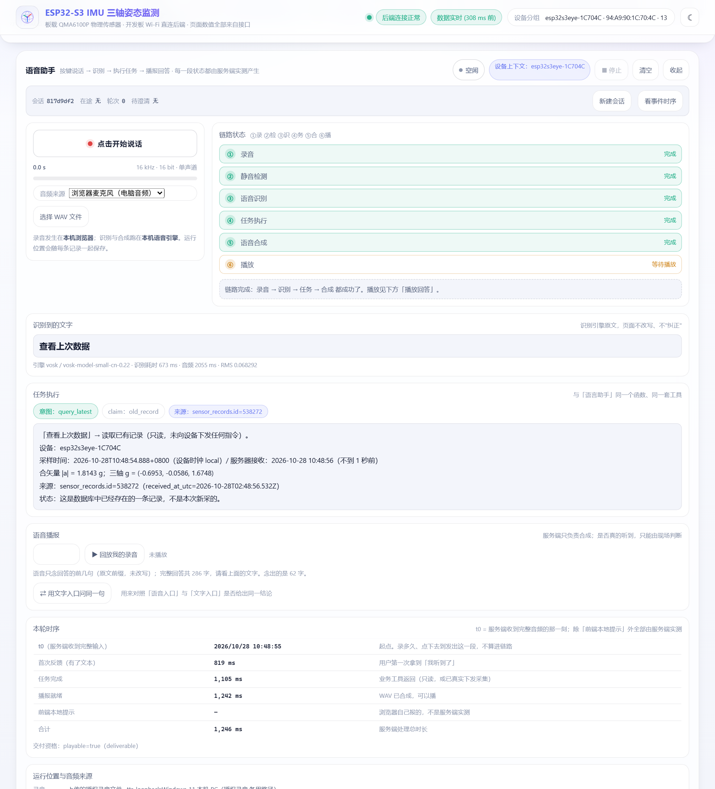
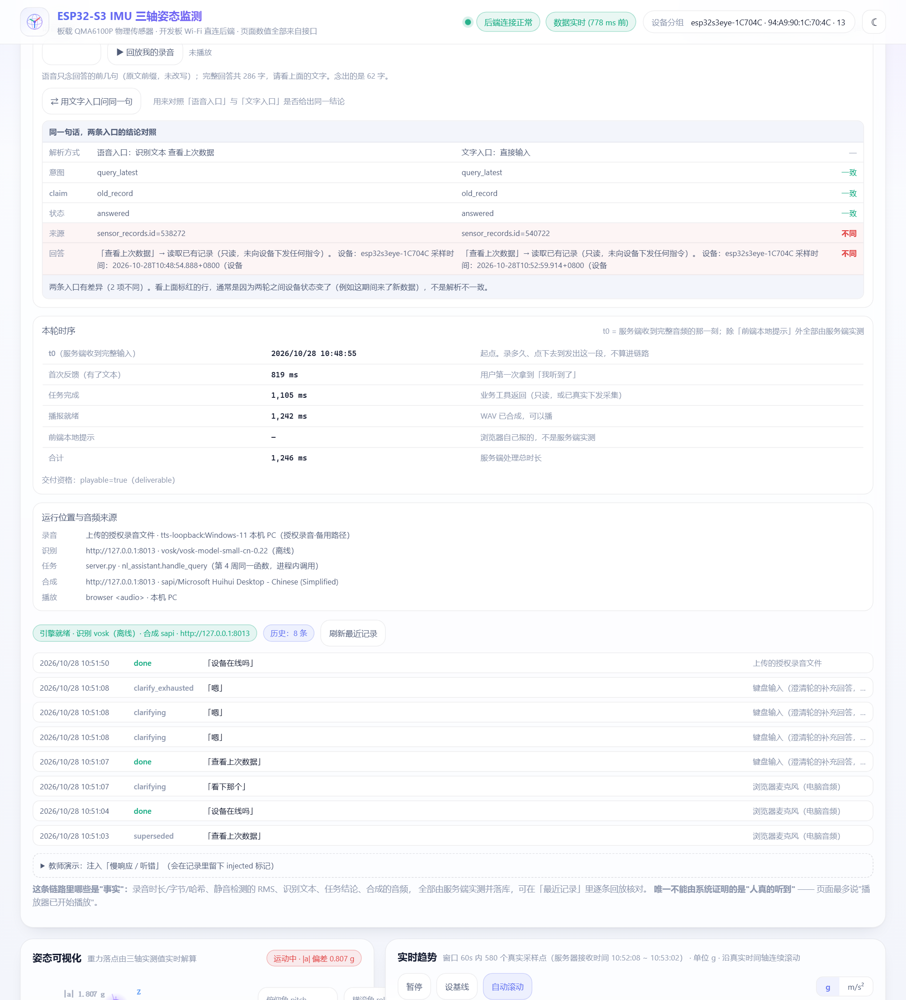

# ESP32-S3-EYE · 第 5 周交付：按键说话与语音播报

按一下按钮说话，页面把这句话拆成**六个可观察的环节**——录音 → 静音检测 → 语音识别 →
任务执行 → 语音合成 → 播放——**每一段的状态都由服务端落库**，出问题时能直接指出是哪一段，
而不是只给你一句"失败了"。

它复用第 4 周那个受限工具助手：你说「查看上次数据」，语音入口和打字入口调的是**同一个函数**，
所以两种方式的结论必须一致——页面上有一张并排对照表，专门把这件事摆出来给你看。

| 项目 | 说明 |
|---|---|
| 交付分支 | `feature/week5-voice-assistant` |
| 运行环境 | Windows 10/11（语音合成用系统 SAPI）；识别、任务、网页跨平台，Python 3.9+ |
| 依赖 | 主后端 **零第三方依赖**；语音引擎只要 2 个包 + 1 个 44 MB 离线模型（`backend/requirements-voice.txt`） |
| 本周新增 | 2 个后端模块（`voice_engine.py` / `voice_pipeline.py`）、1 个前端面板（`#voicePanel`）、1 张表（`voice_turns`）、3 套自检脚本 |
| 自检结果 | 接口 **106/106** · 前端 **72/72** · 网页契约 **通过**（DOM 108 个齐全、0 处兜底假值） |
| 真机状态 | 2026-10-28 在真实板卡 + 真实录音上跑通，单轮端到端 **1.25 秒** |

---

## 1. 本周要回答的问题

> **从「说一句话」到「听到回答」，中间要经过哪些可观察的环节？**

答案是：把它拆成六段，**每段都留下证据**，并且明确"哪一段能把话说死、哪一段不能"。

```text
① 录音   浏览器按键开始/结束 → 采集 → 重采样 16000Hz/16bit/单声道 → 带 RIFF 头
   │     证据：字节数、时长、采样率、位深、声道、SHA256（后端实测，不是前端自报）
② 静音   RMS / 峰值 / 过零率 + 阈值判定
   │     证据：三个实测值与两个阈值；不达标 → 直接认定"没说有效的话"，不进识别
③ 识别   vosk 离线中文小模型（本机 CPU，不联网）
   │     证据：识别文本 + 引擎名 + 模型名 + 耗时
④ 任务   复用第 4 周 nl_assistant.handle_query —— 同一个函数、同一套工具白名单
   │     证据：意图 / claim / 远端状态 / 来源 id
⑤ 合成   Windows SAPI 中文语音 → WAV
   │     证据：语音名、耗时、音频时长与字节数；只念原文前 2 句，不改写
⑥ 播放   浏览器 <audio> 播放，用户点「我听到了」才上报
         证据：只记"播放器已开始播放"。**是否真的听到，服务端不推断**
```

这张图是本项目的核心设计：**①–⑤ 全部可被机器验证，⑥ 只能由现场判定**。
所以页面上第 ⑥ 段永远显示「等待播放」，而不是假装打过勾。

---

## 2. 一次完整的语音交互



这张图是 2026-10-28 10:48:55 的**真实一轮**（`vt_6036090a6b07a3f4cbed`），值得看的是：

- 左边：录音按钮、音频来源（浏览器麦克风 / 授权 WAV 文件）、采样格式 `16 kHz · 16 bit · 单声道`；
- 右边：六段状态，前五段「完成」、第六段「等待播放」——**没有一段是前端算出来的**；
- 识别文本「查看上次数据」，底下小字给出引擎 `vosk / vosk-model-small-cn-0.22`、识别 673 ms、
  音频 2055 ms、RMS 0.068292；
- 任务执行：`意图 query_latest`、`claim old_record`、`来源 sensor_records.id=538272`，
  回答里明写「**只读，未向设备下发任何指令**」；
- 语音播报：「语音只念回答的前几句（原文前缀，未改写）；完整回答共 286 字，念出的是 62 字」
  ——节选规则写在界面上，不藏着；
- 本轮时标：`t0 → 首次反馈 819ms → 任务完成 1105ms → 播报就绪 1242ms → 合计 1246ms`，
  交付资格 `playable=true`；
- 运行位置：录音在本机浏览器、识别与合成在本机 `127.0.0.1:8013` 的独立引擎进程、
  任务在同一进程内调 `nl_assistant.handle_query`。**每一轮都记，失败的那轮也记。**

---

## 3. 同一句话，两条入口对照



上半部分是并排对照：`解析方式 / 意图 / claim / 状态 / 来源 / 回答`。
这张图里有 **4 项一致、2 项标红**，而且页面自己写清了原因：

> 两条入口有差异（2 项不同）。看上面标红的行，通常是因为两轮之间设备状态变了
> （例如这期间来了新数据），不是解析不一致。

这正是想要的行为：设备在以 10 Hz 持续上传，语音那一轮（10:48:55）读到的是当时的"最新一条"
（`id=538272`），对照时文字入口读到的是 3 分钟后的"最新一条"（`id=540722`）——
**来源 id 不同是数据在动，不是两套解析**。意图、claim、状态三项完全一致，说明
"语音只是换了一种输入方式，任务语义没有被改变"。

如果想让两轮读到同一条记录，页面和探针都给了办法：先暂停设备周期上报，再依次跑两条入口。

---

## 4. 三步跑起来

```bash
git clone -b feature/week5-voice-assistant https://github.com/xxx1-sg/ESPwork.git
cd ESPwork
python backend/server.py          # 浏览器打开 http://127.0.0.1:8000/
```

主后端不需要 `pip install`（只用标准库）。**此时页面、曲线、语言助手、这个语音面板全都能开**，
只是语音面板第 ③⑤ 段会如实显示「识别引擎未就绪」——不会装作能用。

想要真的说话和播报，另开一个窗口：

```bash
# ① 装依赖（只有两个包）
pip install -r backend/requirements-voice.txt

# ② 下载离线中文模型（约 44 MB，一次性，之后完全离线）
#    https://alphacephei.com/vosk/models/vosk-model-small-cn-0.22.zip
#    解压到  .models/vosk-model-small-cn-0.22   ← 目录名不要改

# ③ 起语音引擎（默认只监听 127.0.0.1:8013，不对外暴露）
python backend/voice_engine.py
```

Windows 上可以用脚本一条命令完成 ③（它会帮你设环境变量、检查模型、起完自检）：

```powershell
powershell -ExecutionPolicy Bypass -File tools\start_voice_engine.ps1
```

> **为什么引擎要单独一个进程**：主后端坚持零第三方依赖，而真实语音必然要引入运行时。
> 拆开之后还有个更重要的好处——**引擎挂了、超时了、合成失败了，打字入口一行代码都不受影响**。
> 这条是自检里专门钉死的（红线 V3），不是口头承诺。

---

## 5. 15 分钟验收路径

不想手搓 WAV 文件的话，用探针一条命令跑完整链路（它会先用系统语音合成一句话当输入，
再走真实的识别 → 任务 → 合成，全程真实，只是省掉了麦克风）：

```bash
# ① 一轮完整链路：合成"查看上次数据"当输入 → 识别 → 查询 → 播报
python tools/voice_probe.py --say "查看上次数据" --device esp32s3eye-1C704C
# 期望：final_state=done · 六段前五段完成 · 意图 query_latest · claim old_record

# ② 静音：验证"没说有效的话"这条分支
python tools/voice_probe.py --silence
# 期望：final_state=no_speech · 识别文本为空 · 后四段 skipped · 错误里给实测 RMS 与阈值

# ③ 五句标准句（含越界与无关句）
python tools/voice_probe.py --suite --device esp32s3eye-1C704C

# ④ 两入口对照
python tools/voice_probe.py --compare "查看上次数据" --device esp32s3eye-1C704C
```

想直接用 HTTP 验（自带自己的录音时）：

```bash
# 上传一段 WAV（16000 Hz / 16 bit / 单声道 / PCM），立刻返回这一轮的完整状态
curl -s -X POST "http://127.0.0.1:8000/api/v1/voice/turn?audio_source=uploaded_file&capture_location=tools" \
  -H "Content-Type: audio/wav" --data-binary @你的录音.wav

# 引擎状态（会如实报用的是哪个 ASR/TTS、模型在不在、有没有音频输出设备）
curl -s http://127.0.0.1:8000/api/v1/voice/health

# 最近几轮
curl -s "http://127.0.0.1:8000/api/v1/voice/turns?limit=5"
```

三套自检（可进 CI，不需要麦克风，也不需要板子）：

```bash
python tools/selftest_voice.py    # 106 项：接口层，独立端口 + 临时库，覆盖全部失败分支
node   tools/test_web_voice.js    # 72 项：打桩 DOM 跑真实 app.js，含源码级红线核对
python tools/check_web_contract.py --api http://127.0.0.1:8000   # 网页↔接口契约
```

---

## 6. 六条红线

客户最关心的是"会不会糊弄人"。这里的答案是：**能糊弄的地方都堵死了，堵不住的明写出来**。

| 红线 | 怎么保证 | 谁在盯 |
|---|---|---|
| **V1 没识别就没有文本** | 识别失败时 `transcript` 为 `null`，前端**清空** DOM 文本并隐藏结果区（不是拿 CSS 遮住）。绝不拿上一句顶替、绝不关键字猜一个 | 前端自检做源码级核对 |
| **V2 两个入口同源** | 语音与打字调用同一个 `nl_assistant.handle_query`，意图/claim/回答必须一致，页面上并排给你看 | 接口自检 B 段 |
| **V3 语音坏了不影响文字** | 引擎独立进程；引擎停掉 / 超时 / 合成失败三组用例下，打字入口全部正常 | 接口自检 F/G/H 组 |
| **V4 播放 ≠ 听到** | 页面只说「播放器已开始播放」，服务端只记 `played` 时间戳，**从不推断"用户听到了"** | 源码级禁词核对 |
| **V5 来源与位置必记** | 每轮都记音频来源（浏览器麦克风 / 授权录音 / 设备）与六段各自的运行位置，失败的那轮也记 | 库里字段 + 页面「运行位置与音频来源」区 |
| **V6 格式必校验并回报实测值** | 采样率/位深/声道不符 → 400，报文里给的是**实际测到的参数**，不是一句"格式错误" | 接口自检 D 段 8 个用例 |

失败状态一共七类，每类都有专门的提示语，**只有 `done` 才可能说"完成"**：
`done` / `no_speech` / `asr_failed` / `asr_timeout` / `asr_unavailable` / `task_failed` / `tts_failed`。

---

## 7. 真机实测记录

**2026-10-28 10:48:55，`esp32s3eye-1C704C` 在线，一轮完整链路：**

```text
录音       2.06 秒 · 16000 Hz/16 bit/1 声道 · 65810 字节 · sha256=fed0fc2c9d2c…
静音检测    RMS=0.0683（阈值 0.0060）· 峰值=0.6812（阈值 0.0200）→ 有语音能量
识别       673 ms · vosk / vosk-model-small-cn-0.22 → 「查看上次数据」
任务       286 ms · intent=query_latest · claim=old_record · 来源 sensor_records.id=538272
合成       93 ms · Microsoft Huihui Desktop (zh-CN) → 12.8 秒 WAV（563414 字节）
播放       等待浏览器播放（服务端不推断）
端到端     1246 ms
```

**五句标准句**（同一台设备）全部 `done`，意图分别为
`query_latest` / `request_collect`（`claim=new_record`，真拿到新观测）/
`device_status` / `location`（`claim=no_evidence`，明说没有位置能力）/ `unknown`（不硬猜成指令）。

**静音 60 KB**：`final_state=no_speech`，识别文本为空，后四段 skipped，
错误信息里给的是实测 `RMS 0.0000 / 阈值 0.0060`。

---

## 8. 已知限制（如实说明）

1. **语音合成目前只在 Windows 可用**：用的是系统自带的 SAPI 中文语音（默认 Huihui）。
   识别（vosk）和其余链路跨平台；引擎里留了 `VOICE_TTS_BACKEND` 与外部服务接口，
   换 Linux 需要接一个 TTS 后端，代码位置在 `backend/voice_engine.py`。
2. **合成失败会降级，但不会骗人**：如果机器上音频输出设备被独占或不可用，
   引擎会退到 `tone` 合成音，并在这一轮的记录里写 `tts.engine=tone`、`speaks=false`，
   页面也照实显示。**不会把合成音标成"真人播报"。**
   实测如果长时间高频合成后掉到 `tone`（例如刚跑完一整轮 106 项自检），
   **重启语音引擎即恢复**——重启后连续两轮都是 `sapi / Huihui`，不需要改任何配置。
   引擎启动时会先探 `SpVoice.GetAudioOutputs()`：为 0 就直说"没有音频输出设备"，
   而不是抛一个看不懂的 `COMError`；`/health` 也如实报 `speaks` / `audio_outputs`。
   **注意音频设备可见性是按进程启动时机变的**：同一台机器上，引擎进程可能报
   `audio_outputs=2`（真实 SAPI 可用），而同时新起的 CLI 进程报 `0`。
   所以"TTS 到底行不行"要以**引擎自己的 `/health`** 为准，不要拿别的进程的判断当真。
3. **播报只念前 2 句**（≤160 字），因为完整回答平均 300+ 字、全文念出来 64 秒。
   规则是"只截断、不改写"，末尾会加一句"（完整回答见屏幕。）"，界面上一并写明。
4. **本周不用板子的麦克风**：音频采集在浏览器（或上传的授权录音文件）。
   板载麦克风的音频能力尚未验证，按课程要求不把它作为本周前提；
   数据模型里已经留了 `audio_source=device_mic` 这个取值，接入时不改协议。
5. **中文识别会有个别错字**：小模型对短句的实测是"六句五句逐字正确"，
   但意图识别不受影响（「开发版在哪里」照样被正确判成 `location` 并如实说"没有位置能力"）。
6. 仓库里还包含第 6 周的内容（澄清与停止，`docs/14`、`backend/voice_session.py`），
   **不在本分支的验收范围**，为保证服务能正常启动而保留。

---

## 9. 目录导航

| 目录 / 文件 | 是什么 |
|---|---|
| `backend/voice_engine.py` | **本周新增**：独立语音引擎（vosk 识别 + SAPI 合成），默认 `127.0.0.1:8013` |
| `backend/voice_pipeline.py` | **本周新增**：六段编排（格式校验 → VAD → 识别 → 任务 → 合成 → 落库），纯标准库 |
| `backend/nl_assistant.py` | 第 4 周的受限工具助手，语音入口复用的就是它 |
| `backend/server.py` | 零依赖 HTTP 服务：采集、相机、求助、语言助手、语音全部接口 |
| `web/` | 原生 JS 页面：实时曲线、采集面板、按键求助、相机、语言助手、语音面板 |
| `tools/selftest_voice.py` | 接口层自检 106 项（A–K 组，覆盖全部失败分支） |
| `tools/test_web_voice.js` | 前端自检 72 项（打桩 DOM 跑真实 `app.js`） |
| `tools/voice_probe.py` | 端到端探针：单句 / 套件 / 静音 / 两入口对照 / 用自己的 WAV |
| `tools/shoot_voice.py` | 生成上面两张截图的脚本（CDP 驱动 Edge，不用手工截屏） |
| `docs/13_第5周_按键说话与语音播报.md` | **本周交付文档**：设计、六红线、七类终态、踩坑记录、迁移选题 |
| `docs/00_完整工程手册.md` | 工程的完整技术手册（1–6 周细节） |
| `evidence/voice_week5/` | 每一轮的实测记录（`<turn_id>.json`：六段状态、音频指纹 SHA256、耗时、运行位置） |

---

## 10. 关于这个分支

- 分支：`feature/week5-voice-assistant`，从 `feature/week4-nl-assistant` 继续；
  主分支 `main` 保持第 1 周基线，按周分支便于逐周评审，最后再合并。
- 本周的关键取舍：**宁可少说，也不多说**。识别不确定就承认不确定，任务没回执就说不知道，
  合成不了就标 `tone`，只有现场听到才算"听到"。
- 想只看代码差异：`git diff feature/week4-nl-assistant --stat`；
  想复跑全部自检：见第 5 节。
