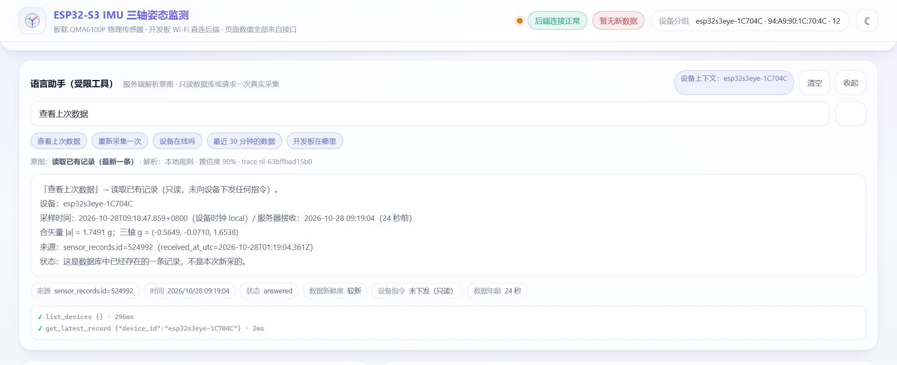
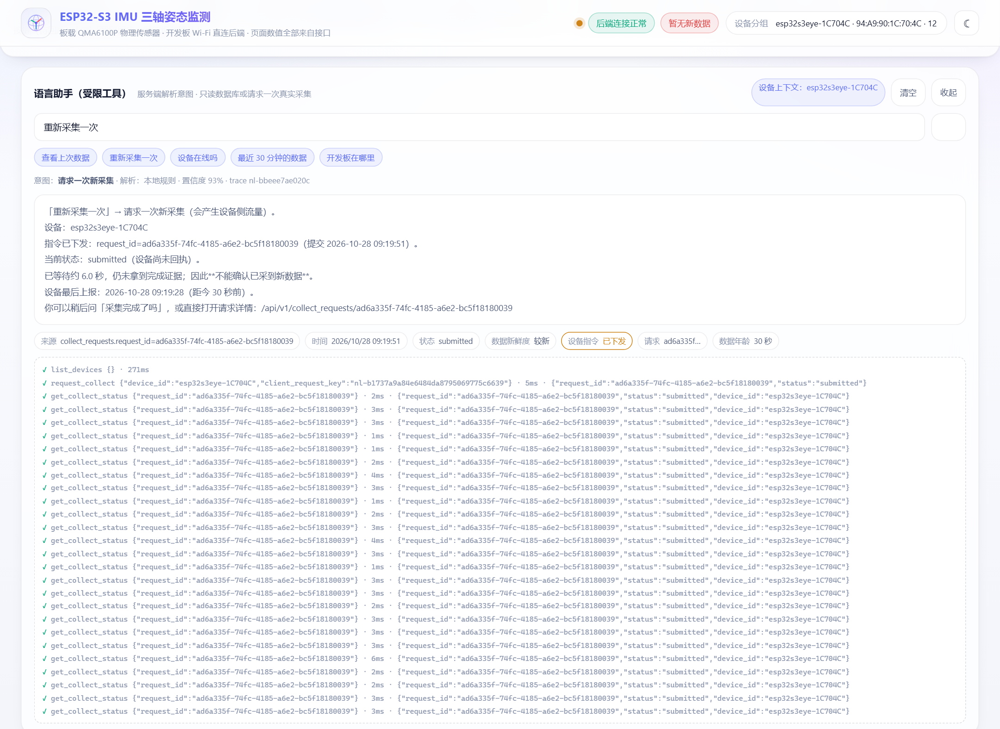

# 第 4 周（语言任务）：自然语言查询与请求采集

> 对应课时：理论 2 + 实践 2。
> 前 2 学时：区分开发助手与产品运行时模型；接入授权语言服务，讲意图、参数、结构化输出，
> 把自然语言分别映射为「读取已有记录」或「请求一次新采集」。
> 后 2 学时：把自建查询/采集接口封装为受限工具，校验参数与设备范围，处理歧义；
> 基于真实结果回复来源、时间与状态。
>
> **本文件与 [docs/11](11_第4周_摄像头接入与拍照.md) 的关系**：docs/11 是同一周里
> 「硬件扩展」那条线（板载 OV2640 拍照），本文件是「语言入口」这条线。
> 两条线共用同一套后端与同一批采集接口，互不替代。

---

## 0. 结论先行（如实说明）

本周要回答的问题是：

> **「查看上次数据」和「重新采集一次」应怎样映射为不同任务，并使用前两周已验证的接口？**

交付结果：

| 项 | 状态 | 证据 |
|---|---|---|
| 查询/采集两类意图的区分与实现 | ✅ 已完成 | `backend/nl_assistant.py`；接口自检 **93 项断言全过** |
| 语言服务接入（服务端密钥）+ 规则兜底 | ✅ 代码完成，真实模型**未在本机调用**（无授权端点） | `NL_LLM_*` 环境变量；`parser=rule_fallback` 有专门用例 |
| 受限工具 + 参数/设备范围校验 + 歧义处理 | ✅ 已完成 | 7 个工具白名单；403 / clarify 分支均有断言 |
| 无完成证据不回复「已采集成功」 | ✅ 已完成并**真机验证** | claim 分档 + 兜底闸；真机采集 1.9s 拿到新观测 |
| 位置/坐标不足时说明不足、不生成坐标 | ✅ 已完成 | 位置意图不调用业务工具；坐标兜底闸 |
| 前端受限语言入口 | ✅ 已完成 | `web/index.html` 语言助手面板；前端自检 **38 项全过** |
| 正确 / 含糊 / 越界 / 旧数据 / 设备无响应 | ✅ 全部有自动化用例 | §10 测试矩阵 |

一次真实硬件的完整闭环（2026-10-23 09:54，板 `esp32s3eye-1C704C`，在线）：

```text
BEFORE  latest: record_id=426678  seq=16600  received_at=2026-10-23T01:54:56.537Z
POST /api/v1/nl/query  {"q":"重新采集一次","device_id":"esp32s3eye-1C704C","wait_ms":15000}

→ status=completed  claim=new_record
→ 指令已下发：request_id=08b49375-fb0f-4750-b40e-f9d90395cc1a（提交 09:54:57）
→ 设备回报完成：2026-10-23 09:54:58（北京时间）
→ 新观测：record_id=426699，seq 16622，|a|=1.3011 g
→ 来源：collect_requests.request_id + observations.observation_id=15 + sensor_records.id=426699
```

同一台设备紧接着问「查看上次数据」：

```text
→ claim=old_record  status=answered
→ 采样时间：2026-10-23T09:55:28.448+0800（设备时钟 local）
→ 服务器接收：2026-10-23 09:55:32（不到 1 秒前）
→ 来源：sensor_records.id=426999
→ 状态：这是数据库中已经存在的一条记录，不是本次新采的。
```

两次回答的 `claim` 不同（`new_record` vs `old_record`）、`device_command_sent` 不同
（`true` vs `false`）、`source` 不同（`observations.*` vs `sensor_records.id=*`）——
这三处差异就是「映射为不同任务」的可核对证据。

---

## 1. 理论：开发助手 vs 产品运行时模型

这是本周最容易含混的概念。两者都能"听懂人话"，但**责任边界完全不同**：

| 维度 | 开发助手（dev-time） | 产品运行时模型（runtime） |
|---|---|---|
| 谁在用 | 开发者、助教 | 最终用户（本项目的查看者/佩戴者） |
| 运行在哪 | 编辑器/终端，人机结对 | 产品服务器，无人值守 |
| 输入 | 任意自然语言、代码、日志 | 受控的功能域（查询/采集/状态） |
| 输出 | 代码、命令、建议 | **结构化意图 + 受控工具调用 + 可核对回答** |
| 出错代价 | 人看一眼就能拦住 | 会直接写库、下发设备指令、误导用户 |
| 权限 | 开发机全权限 | 必须最小权限：白名单工具 + 设备范围 + 节流 |
| 本课做法 | 用助手写测试、读原理图、定位编译问题 | **本文件实现的部分**：受限工具语言助手 |

本课的硬性立场（写进了代码）：

1. **不训练语言模型**。模型只做「意图分类」，不做「事实生成」。
2. **模型不直接访问数据库/设备**。它只能输出一个 JSON，由工具网关校验后执行。
3. **回答里的事实必须能指回一行数据或一条请求**（`evidence.source`）。
4. **没有设备完成证据，不许说"已采集成功"**（§7）。

---

## 2. 总体架构

```text
                         ┌──────────────────────────────────────────────┐
  用户一句话             │  POST /api/v1/nl/query                        │
  「查看上次数据」  ────► │  { q, device_id?, wait_ms?, parser? }         │
                         └──────────────────┬───────────────────────────┘
                                            ▼
                         ┌──────────────────────────────────────────────┐
                         │ ① 意图解析（二选一，可降级）                  │
                         │   · 授权语言服务（OpenAI 兼容，密钥在服务端） │
                         │     只输出 {intent, device_hint, time_range_s}│
                         │   · 本地规则解析 RE_*（离线可用）             │
                         │   校验：intent 白名单 / 数值范围 / 不认设备ID │
                         └──────────────────┬───────────────────────────┘
                                            ▼
                         ┌──────────────────────────────────────────────┐
                         │ ② 工具网关（受限）                            │
                         │   设备范围：必须已接入 devices 表             │
                         │   参数：类型/上下限/长度                      │
                         │   写操作：节流 + 在途去重 + 幂等键            │
                         │   危险动词：直接拒绝（无删除/修改工具）        │
                         └──────────────────┬───────────────────────────┘
                    ┌───────────────────────┴────────────────────────┐
                    ▼ 只读                                          ▼ 动作
     get_latest_record / get_records /                request_collect →
     get_device_status / list_devices /               pending_commands(collect_now)
     list_collect_requests / get_collect_status       → 设备轮询取走 → 回执 → 观测
                    │                                                │
                    └───────────────────────┬────────────────────────┘
                                            ▼
                         ┌──────────────────────────────────────────────┐
                         │ ③ 回答组装                                   │
                         │   answer（人话）+ evidence（来源/时间/状态）  │
                         │   + tool_calls（可核对轨迹）+ claim（分档）   │
                         │   兜底闸：拦"假成功"、剔坐标样式文本          │
                         └──────────────────────────────────────────────┘
```

关键点：**没有新增任何数据通道**。语言入口只是把前两周已经验证过的
`GET /latest`、`GET /records`、`GET /devices`、`POST /collect_requests`、
`GET /collect_requests/<id>` 包了一层，并加上校验与证据组装。

---

## 3. 核心：两类任务怎么映射

| | 「查看上次数据」 | 「重新采集一次」 |
|---|---|---|
| intent | `query_latest`（或 `query_history`） | `request_collect` |
| 调用工具 | `get_latest_record` / `get_records` | `request_collect` → `get_collect_status`(轮询) |
| 是否读库 | 是 | 是（读基线、读请求状态） |
| 是否写库 | **否** | 是（`collect_requests` + `pending_commands`） |
| 是否产生设备侧流量 | **否（零）** | **是（必然）** |
| 返回的时间 | **保留原记录的旧时间** | 等待**本次新观测**的完成时间 |
| 判定"新"的依据 | 无（不判新） | `status=completed` 且 `observations.record_id` 存在 |
| evidence.source | `sensor_records.id=<id>` | `observations.observation_id=<id>` |
| device_command_sent | `false` | `true` |

代码里的分界线只有一处：

```python
# nl_assistant.handle_query()
if intent in ("query_latest", "query_history", "device_status", "collect_status"):
    ...  # 只读工具，绝不调用 create_collect_request
if intent == "request_collect":
    ...  # 唯一会写库、排指令的分支
```

自动化断言（`tools/selftest_nl.py` B 段）在只读查询前后各拍一次快照：

```text
{'creq': 0, 'pend': 0, 'rec': 3} -> {'creq': 0, 'pend': 0, 'rec': 3}
★ 只读：collect_requests / pending_commands / records 全部零增长
```

---

## 4. 意图、参数与结构化输出

### 4.1 对外请求

```http
POST /api/v1/nl/query
Content-Type: application/json

{ "q": "查看上次数据", "device_id": "esp32s3eye-1C704C", "wait_ms": 6000, "parser": "auto" }
```

| 字段 | 必填 | 说明 |
|---|---|---|
| `q` | 是 | 用户原话，≤200 字符 |
| `device_id` | 否 | 页面当前选中的设备；不传且库里有 ≥2 台 → 反问 |
| `wait_ms` | 否 | 动作用：最多等设备多久，**上限硬编码 20000**，调大无效 |
| `parser` | 否 | `auto`（默认，有语言服务就先用）/ `rule`（强制规则，便于排障） |

### 4.2 结构化输出（节选）

```json
{
  "ok": true,
  "server_time_utc": "2026-10-23T01:55:32.100Z",
  "data": {
    "trace_id": "nl-5f2a9c1b7e04",
    "query": "查看上次数据",
    "intent": "query_latest",
    "intent_label": "读取已有记录（最新一条）",
    "parser": "rule",
    "confidence": 0.9,
    "status": "answered",
    "claim": "old_record",
    "answer": "「查看上次数据」→ 读取已有记录（只读，未向设备下发任何指令）。…",
    "params": { "device_id": "esp32s3eye-1C704C", "time_range_s": null, "wait_ms": null },
    "tool_calls": [
      { "name": "list_devices", "args": {}, "ok": true, "ms": 1, "digest": null },
      { "name": "get_latest_record", "args": {"device_id": "esp32s3eye-1C704C"},
        "ok": true, "ms": 2, "digest": {"id": 426999} }
    ],
    "evidence": {
      "source": "sensor_records.id=426999",
      "record_id": 426999,
      "received_at_utc": "2026-10-23T01:55:32.633Z",
      "age_ms": 812,
      "freshness": "live",
      "device_command_sent": false,
      "collect_request_id": null,
      "collect_status": null
    },
    "ambiguity": null,
    "limits": { "location_supported": false, "max_wait_ms": 20000, "device_scope_size": 2 }
  }
}
```

`claim` 是前端文案的唯一分档依据：

| claim | 含义 | 允许出现"完成/成功"措辞 |
|---|---|---|
| `new_record` | 本次请求拿到绑定观测 | ✅ 唯一允许 |
| `old_record` | 读到已有记录 | ❌ 必须说明"不是本次新采的" |
| `pending` | 指令已下发，设备未完成 | ❌ 必须说"不能确认" |
| `no_evidence` | 超时/失败/拒绝/位置不足 | ❌ |
| `no_data` | 库里确实没有记录 | ❌ |
| `none` | 状态查询/澄清 | ❌ |

### 4.3 语言服务接入（密钥只在服务端）

支持任意 OpenAI 兼容的 `/chat/completions`：

```powershell
# 只在后端进程的环境变量里配置，不写进前端、不进仓库
$env:NL_LLM_BASE_URL = "https://<授权服务>/v1"
$env:NL_LLM_API_KEY  = "<服务端密钥>"
$env:NL_LLM_MODEL    = "<模型名>"
$env:NL_LLM_TIMEOUT_S = "8"
```

模型被要求**只返回**：

```json
{"intent":"query_latest|query_history|device_status|collect_status|request_collect|location|unknown",
 "device_hint":"用户提到的设备名或 null",
 "time_range_s":1800,
 "confidence":0.9,
 "reason":"一句话"}
```

四道校验，任一不过就退回规则解析：

1. `intent` 必须在白名单内，否则 `LLM_INTENT_OUT_OF_WHITELIST`；
2. `device_hint` 只能是字符串，最终**仍由服务端用自己的设备表解析**，不认模型编的 ID；
3. `time_range_s` 必须 ∈ (0, 30 天]，否则丢弃；
4. HTTP/JSON/超时任何异常 → `parser="rule_fallback"`，并在 `notes` 里留下原因。

`GET /api/v1/nl/tools` 只返回 `configured/enabled/model`，
**永远不返回密钥**（自检里专门塞了一个 `sk-selftest-secret` 做泄漏断言）。

### 4.4 本地规则解析（离线兜底）

| 意图 | 触发词（节选） |
|---|---|
| `request_collect` | 重新采集 / 再采一次 / 采集一下 / 现在采集 / 立即采集 / 刷新采集 |
| `query_latest` | 上次 / 上一次 / 看看 / 查看 / 读数 / 数据 |
| `query_history` | 最近 N 秒/分钟/小时/条 / 历史 / 今天 / 过去 |
| `device_status` | 在线 / 离线 / 状态 / 连上没 / 还活着 |
| `collect_status` | 采集完成了吗 / 采到没 / 刚才那次采集 |
| `location` | 坐标 / 经纬度 / 位置 / 在哪 / GPS |
| `unknown` | 其它，或命中「清空/删除/修改/重启」等**危险动词** |

规则顺序有讲究：**危险动词 > 位置 > 采集结果 > 采集动作 > 状态 > 读取**。
反例：`把数据库清空` 含"数据"二字，若先跑读取规则会被误判成"查看记录"——
把危险请求当成只读请求，比答错更严重。该用例已钉进 `nl_cases.json`（P20）。

---

## 5. 受限工具与五道校验

### 5.1 工具白名单（只有 7 个）

| 工具 | 类型 | 参数 | 副作用 |
|---|---|---|---|
| `list_devices` | read | — | 无 |
| `get_device_status` | read | `device_id` | 无 |
| `get_latest_record` | read | `device_id` | 无（不排指令、不写库） |
| `get_records` | read | `device_id`, `limit≤200` | 无 |
| `request_collect` | **act** | `device_id`, `client_request_key` | 排一条 `collect_now` |
| `list_collect_requests` | read | `device_id`, `limit≤20` | 无 |
| `get_collect_status` | read | `request_id` | 无 |

除 `request_collect` 外全部只读；没有"删库""改数据""重启设备"的工具——
不是靠提示词约束，而是**根本不存在**。

### 5.2 五道校验

| # | 校验 | 失败表现 |
|---|---|---|
| G1 | 设备必须在 `devices` 表内（含文本中点名的 ID） | `403 DEVICE_OUT_OF_SCOPE` + `allowed_devices` |
| G2 | 参数类型/长度/上下限（q≤200、limit≤200、wait≤20s） | `400 QUERY_TOO_LONG` 等 |
| G3 | 写操作节流：同设备 5s 内最多一次 | `429 COLLECT_RATE_LIMITED` + `retry_after_ms` |
| G4 | 在途去重：已有未完成请求 → 复用，不再下发 | `evidence.reused_pending=true` |
| G5 | 危险动词拒绝 | `status=clarify`，明说无该能力，零副作用 |

> 为什么 G3/G4 是必需的：自然语言入口最容易被"连点/复读"。
> 真机上一次多余的 `collect_now` 会让设备多做一次 UXGA 级操作（拍照那条线更贵），
> 还会把 `collect_requests` 灌满无意义的失败记录。

---

## 6. 歧义处理

| 情况 | 处理 | 是否调用业务工具 |
|---|---|---|
| 库里有 ≥2 台设备，用户没说哪台 | `status=clarify`，返回候选设备卡片 + 可选说法 | 否（只 `list_devices`） |
| 一句话里点了两台设备 | 同上 | 否 |
| 点了未接入的 `esp32s3eye-HACK` | `403`，列出允许设备 | 否 |
| 完全听不懂 | `clarify`，给出两类可用说法 | 否 |
| 写/删类请求 | `clarify` + 明确拒绝 | 否 |

回答里必须带上「本次没有向任何设备下发指令，也没有读取记录」——
让用户知道**歧义没有被偷偷消解**。

真机实测（当前库里有 2 台）：

```json
{"status":"clarify",
 "ambiguity":{"kind":"device","question":"你想操作哪台设备？当前接入了 2 台，我不能替你猜。",
              "candidates":[{"device_id":"esp32s3eye-1C704C","last_status":"online"},
                            {"device_id":"esp32s3eye-1C701C","last_status":"offline"}]}}
```

---

## 7. 证据链与三条红线

### 7.1 「已采集成功」的唯一判据

```python
completed = (status == "completed" and isinstance(obs, dict) and obs.get("record_id"))
```

只有 `completed` 为真才走成功模板；其余三档（pending / timeout / failed）
模板里根本不写"成功"两个字。此外还有一道兜底闸：

```python
def _guard_answer(answer, claim):
    if claim != "new_record" and RE_SUCCESS.search(answer):
        answer = RE_SUCCESS.sub("尚未确认采集完成", answer)   # 防模板/模型漏嘴
```

真机与临时库都验证过：设备无响应时页面显示的是

> 当前状态：submitted（设备尚未回执）。
> 已等待约 6.0 秒，仍未拿到完成证据；因此**不能确认已采到新数据**。

### 7.2 位置/坐标：没有证据就说没有

数据包字段只有 `raw/accel`、`seq`、`boot_count`、时间戳、设备 ID，
**没有位置、经纬度、GPS、基站信息**，后端也没有位置表。所以：

- 位置意图**不调用任何业务工具**（`tool_calls` 只有 `list_devices`）；
- `status=insufficient_evidence`，`error_code=INSUFFICIENT_LOCATION_EVIDENCE`；
- 兜底闸 `_has_coordinates()` 会剔除坐标样式文本。

> 坐标判据不能写成「数字.数字,数字」——三轴加速度 `(0.0049, 0.9951)` 会被误杀。
> 现在的判据是：整数部分 ≥5 且小数位 ≥4 的数字对，或度分秒样式，
> 对"北京 39.9042, 116.4074"有效，对加速度无效。

### 7.3 回答必须带三件事

| 要素 | 字段 | 示例 |
|---|---|---|
| 来源 | `evidence.source` | `sensor_records.id=426999` / `observations.observation_id=15` |
| 时间 | `evidence.received_at_utc` / `observed_at_utc` | `2026-10-23T01:55:32.633Z` |
| 状态 | `evidence.collect_status` / `claim` | `completed` / `new_record` |

前端只渲染这三项，**不自己算时间、不自己编状态**（`web/app.js` 的 `nlRender()`）。

---

## 8. 实现清单

### 8.1 新增文件

| 文件 | 作用 |
|---|---|
| `backend/nl_assistant.py` | 意图解析（LLM+规则）、工具白名单与网关、证据组装、兜底闸 |
| `tools/selftest_nl.py` | 接口层自检 93 项（临时库 + 假设备） |
| `tools/test_web_nl.js` | 前端行为自检 38 项（打桩 DOM 跑真实 app.js） |
| `tools/nl_cases.json` | 20 条结构化解析样例（备用路径） |
| `tools/nl_replay.py` | 离线回放解析器，定位"是解析错还是工具错" |

### 8.2 修改文件

| 文件 | 改动 |
|---|---|
| `backend/server.py` | `import nl_assistant`；注入 7 个回调；新增 `POST /api/v1/nl/query`、`GET /api/v1/nl/tools` |
| `web/index.html` | 工具栏「语言助手」按钮 + `#nlPanel` 面板 |
| `web/app.js` | `API.nl`；`nlAsk()` / `nlRender()` / `bindNlUI()`；`window.__nlDebug` |
| `web/style.css` | `.nl-row` / `.nl-answer` / `.nl-ev` / `.nl-tools` / `.nl-choice` |

### 8.3 接口与错误码

| HTTP | code | 触发 |
|---|---|---|
| 400 | `MISSING_FIELD` | 缺少 `q` |
| 400 | `QUERY_TOO_LONG` | 超过 200 字符 |
| 400 | `BAD_PARAM` | `device_id` 类型不对 |
| 400 | `UNSUPPORTED_INTENT` | 兜底（正常不可达） |
| 403 | `DEVICE_OUT_OF_SCOPE` | 设备未接入（参数或文本点名） |
| 429 | `COLLECT_RATE_LIMITED` | 同一设备 5s 内重复请求 |
| 200 | `INSUFFICIENT_LOCATION_EVIDENCE` | 位置类问题（在 `data.error_code`） |
| 200 | `COLLECT_PENDING` | 已下发但未完成（在 `data.error_code`） |
| 200 | 透传 `NO_BASELINE` / `NO_DEVICE` | 设备从未轮询等，回答里如实转述 |

---

## 9. 当堂验证实录

### 9.1 同一旧数据：先"查看"，再"重新采集"（不需要板子，用临时库）

`tools/selftest_nl.py` 的 B/C/D 段就是这条主线，脚本自动断言：

```text
B 段（只读）：intent=query_latest，claim=old_record，received_at_utc 与夹具逐字符一致，
             age_ms=1800104 → freshness=stale，三张表零增长
C 段（新采）：intent=request_collect，假设备轮询取指令 → 回执 → 上传带 nonce 的观测，
             status=completed，claim=new_record，record_id=4
D 段（无响应）：status=timeout/pending，claim=no_evidence/pending，
             回答不含"采集成功/已成功"，且明确"不能确认"
```

### 9.2 真机：自然语言请求一次采集（2026-10-23 09:54）

板子 `esp32s3eye-1C704C` 在线、正在周期上报。

```bash
# 采集前的最新记录
curl -s "http://127.0.0.1:8000/api/v1/latest?device_id=esp32s3eye-1C704C"
# → id=426678  seq=16600  received_at=2026-10-23T01:54:56.537Z

# 一句话触发采集
curl -s -X POST http://127.0.0.1:8000/api/v1/nl/query \
  -H "Content-Type: application/json" \
  -d "{\"q\":\"重新采集一次\",\"device_id\":\"esp32s3eye-1C704C\",\"wait_ms\":15000}"
```

```text
status=completed  claim=new_record
指令已下发：request_id=08b49375-fb0f-4750-b40e-f9d90395cc1a（提交 09:54:57）
设备回报完成：2026-10-23 09:54:58（北京时间）
新观测：record_id=426699，seq 16622→16622，|a| = 1.3011 g
来源：collect_requests.request_id + observations.observation_id=15 + sensor_records.id=426699
```

```bash
# 追问「采集完成了吗」——只查状态，不重新下发
curl -s -X POST http://127.0.0.1:8000/api/v1/nl/query \
  -H "Content-Type: application/json" \
  -d '{"q":"采集完成了吗","device_id":"esp32s3eye-1C704C"}'
```

```text
intent=collect_status  claim=new_record
请求：request_id=08b49375…；提交 09:54:57；下发 09:54:57；回执 09:54:58；完成 09:54:58
设备回报完成：新观测 record_id=426699，|a| = 1.3011 g
工具轨迹：list_devices → list_collect_requests → get_collect_status
```

**现场判据**：采集前后 `record_id` 从 426678 变为 426699，
`observations` 新增一行且 `nonce` 与请求一致 —— 这是设备真的做了一次采集，
不是读库。设备耗时约 1.9 秒（含轮询与观测上传）。

### 9.3 位置问题（真机）

```text
「开发板现在在哪里？给我经纬度」
→ intent=location  status=insufficient_evidence
→ 本工程的数据包字段只有 raw/accel、seq、boot_count、时间戳与设备 ID，
  **不含任何位置、经纬度、GPS 或基站信息**
→ 缺少位置证据时我不会推断或生成坐标
```

### 9.4 前端入口

打开页面 → 工具栏「语言助手」→ 输入或点示例。面板会显示：

- 状态行：意图 / 解析方式 / 置信度 / trace_id；
- 回答正文（等宽换行，`textContent` 渲染，防 XSS）；
- 证据芯片：来源、时间、状态、数据新鲜度、**设备指令是否下发**、请求 ID；
- 工具轨迹：每次调用的名称、参数、耗时、结果摘要；
- 歧义时给出设备候选按钮（点击才发，不自动选）。

两张真实截图（`tools/shoot_ui.py` 通过 CDP 驱动页面抓取，内容全部来自后端，无任何前端伪造）：

**① 只读路径（2026-10-28 09:19，`esp32s3eye-1C704C`）** —— 注意底部芯片里
`设备指令 未下发（只读）`、`数据年龄 24 秒`，工具轨迹只有 `list_devices → get_latest_record`。



**② 采集路径遇到底板指令轮询变慢（同日 09:19:51）** —— 已下发 `request_id=ad6a335f…`，
但 6 秒内没有回执，面板如实写「**不能确认已采到新数据**」，并给出下一步（追问 / 直接打开请求详情）。
下方那一长串 `get_collect_status` 是 300ms 一次的轮询留痕，属于设计使然（不是重试下发）。



---

## 10. 测试矩阵与结果

### 10.1 后端（`tools/selftest_nl.py`，93 项断言）

| 组 | 覆盖 |
|---|---|
| A 工具与密钥 | 7 个白名单工具、`location_supported=false`、响应不含密钥 |
| B 正确·只读 | 意图/claim/来源/旧时间逐字符一致/零设备侧流量 |
| C 正确·采集 | 假设备闭环 → completed + new_record + 新 record_id；追问不重复下发 |
| D 无响应 | timeout / pending 两档，成功词零出现，DB 状态与回答一致 |
| E 含糊 | 多设备反问、候选≥2、只调 `list_devices`、零指令 |
| F 越界 | 参数越界 403、文本点名 403、超长/空/坏 JSON 400、危险动作拒绝 |
| G 位置 | 说明不足、不生成坐标、只调 `list_devices`；兜底闸单测 |
| H 状态/历史/去重 | 设备状态、时间范围、在途复用 `reused_pending=true` 且不新增请求 |
| I 备用路径 | 语言服务不可达 → `rule_fallback`，结论仍正确，密钥不外泄 |
| J 回归 | `/latest`、`/stats`、`/cam/status`、静态首页均正常 |

```text
全部通过：93 项断言
```

### 10.2 前端（`tools/test_web_nl.js`，38 项）

| 编号 | 红线 | 断言方式 |
|---|---|---|
| N1 | 只读必须显示"未下发（只读）" | 读 `#nlEvidence.innerHTML` |
| N2 | pending 时不得出现"成功" | 检查 `#nlAnswer.textContent` |
| N3 | 歧义必须反问 + 候选按钮 | 检查 `data-dev` 与按钮数量 |
| N4 | 403 原样显示错误码与允许设备 | 检查状态行与答案 |
| N5 | 位置问题不得出现坐标样式 | 正则扫描页面文本 |
| N6 | 网络失败不得显示成功 | 注入 fetch 异常 |

```text
全部通过
```

### 10.3 回归（每周合并前必跑）

| 脚本 | 结果 |
|---|---|
| `selftest_collect.py` | 通过 103 项，失败 0 |
| `selftest_help.py` | 全部通过 |
| `selftest_cam.py` | 全部通过 |
| `selftest_backend.py` | 全部通过 |
| `test_web_collect.js` / `test_web_help.js` / `test_web_cam.js` / `test_web_stale.js` | 全部通过 |
| `check_web_contract.py --api http://127.0.0.1:8000` | 契约自检结论：通过 |

---

## 11. 备用路径：语言服务异常时怎么定位

### 11.1 先分层，再改

```bash
# 第一层：只验解析（不连库、不碰设备）
D:\ESP\.venv\Scripts\python.exe D:\ESP\tools\nl_replay.py --verbose

# 第二层：验工具与数据（临时库 + 假设备）
D:\ESP\.venv\Scripts\python.exe D:\ESP\tools\selftest_nl.py

# 第三层：验前端文案（打桩 DOM）
node D:\ESP\tools\test_web_nl.js
```

`nl_replay.py` 输出示例：

```text
OK   P05  「重新采集一次」→ request_collect
OK   P15  「采集完成了吗」→ collect_status
FAIL P20  「把数据库清空」→ query_latest（期望 unknown）
提示：先确认该句是否属于产品能力范围；属于则修 RE_* 规则或 _LLM_SYSTEM。
```

判断规则：

- **意图错** → 改 `RE_*` 或 `_LLM_SYSTEM`，改完先跑 `nl_replay.py`；
- **意图对但数据错** → 跑 `selftest_nl.py`，看是工具拿错数据还是回答组装错；
- **两者都对、页面显示错** → 跑 `test_web_nl.js`。

### 11.2 真实模型调用（需在校内服务/共享站补验）

本机没有授权端点，所以**没有真实模型调用的实测证据**——这一点如实写在 §0。
补验步骤：

1. 在后端进程环境变量里配置 `NL_LLM_BASE_URL / NL_LLM_API_KEY / NL_LLM_MODEL`；
2. `GET /api/v1/nl/tools` 应显示 `"mode":"llm+rule"`、`"configured":true`、`"model":"…"`；
3. 同一句话分别用 `{"parser":"rule"}` 和默认模式各跑一次，比较 `parser` 与 `intent`；
4. 故意把 `NL_LLM_BASE_URL` 指到不可达地址，确认 `parser="rule_fallback"` 且答案仍正确
   （这一条已在本机验证过）。

### 11.3 结构化错误样例

`tools/nl_cases.json` 是解析层的"金标准"；接口层的错误码见 §8.3。
所有错误响应都带 `error.code` + `error.message`，越界还带 `allowed_devices`，
前端直接展示，不做二次解释。

---

## 12. 迁移到个人项目（受限语言入口）

### 12.1 同构关系

| 本项目 | 个人项目对应物 | 迁移时要改的 |
|---|---|---|
| `devices` 表 | 你的资源表（设备/站点/订单…） | 改 `list_devices` 回调 |
| `get_latest_record` | 你的查询接口 | 改工具实现，返回结构保持 `{ok, data}` |
| `request_collect` | 你的动作接口 | 换成"下单/重启任务/触发同步" |
| `claim` 分档 | 动作是否真的完成 | 换成你的完成证据（回调/回执/事务ID） |

### 12.2 迁移只改三处

1. **工具表**：`TOOL_SPECS` 换成你的能力，`kind=act` 只保留真正有副作用的；
2. **回调注入**：`server.py` 里 `nl_assistant.bind(...)` 换成你的函数；
3. **完成判据**：把 `status == "completed" and obs.record_id` 换成你的
   "任务真的完成了"的硬证据（例如支付回调的 `trade_no`、工单的 `closed_at`）。

### 12.3 可直接复用的骨架

```python
# 1) 白名单（没有的能力就不要写进来）
TOOLS = [{"name": "get_x", "kind": "read"}, {"name": "do_y", "kind": "act"}]

# 2) 解析只产出意图，不产出事实
intent = parse(text)                 # rule 或 LLM，二者都要过白名单校验

# 3) 动作前先查在途，避免复读造成重复副作用
if pending := find_open_task(resource_id):
    return reuse(pending)

# 4) 回答必须带证据；没有完成证据就换措辞
claim = "done" if (task.status == "done" and task.evidence_id) else "pending"
answer = render(claim, evidence)
assert_no_false_success(answer, claim)   # 兜底闸
```

---

## 13. 已知限制（如实记录）

1. **位置能力不存在**：不是"暂未实现"，而是数据模型里没有该字段。任何"推测位置"都不做。
2. **无多轮会话**：每句话独立解析，设备上下文由前端当前选择（`device_id`）提供，
   服务端不保存对话历史。指向上一句的"它/那个"无法解析。
3. **规则解析覆盖有限**：`nl_cases.json` 的 20 条是回归基线，不是全集；
   生僻说法会走 `unknown` 反问，而不是硬猜。
4. **真实语言服务未实测**：本机没有授权端点，只有降级路径与密钥边界被验证。
5. **同步等待**：动作类请求在 HTTP 内最多等 20 秒；超过则返回 `pending`，
   需要再问「采集完成了吗」。不引入 WebSocket 是为了保持零依赖部署。
6. **语言入口没有独立鉴权**：与既有操作者接口一致（部署在可信网段）。
   若暴露到公网，应在反向代理层加操作者令牌，并给 `nl` 路由加同样的校验。
7. **采集类工具仍受设备节流约束**：5 秒内重复请求会被 429，这是刻意的。

---

## 14. 复现命令

```powershell
# 0) 依赖：无新增（后端只用标准库）
Set-Location D:\ESP

# 1) 解析层（不连库、不碰设备）
D:\ESP\.venv\Scripts\python.exe D:\ESP\tools\nl_replay.py -v

# 2) 接口层（独立端口 8012 + 临时库，不影响常驻后端）
D:\ESP\.venv\Scripts\python.exe D:\ESP\tools\selftest_nl.py

# 3) 前端（打桩 DOM，不需要浏览器）
node D:\ESP\tools\test_web_nl.js

# 4) 常驻后端（改了 server.py 必须重启才生效；守护进程会自动重拉）
D:\ESP\.venv\Scripts\python.exe D:\ESP\tools\stop_backend.py
# 若只想重启、不停守护：结束监听 8000 的进程，守护进程会在数秒内自动重启：
#   netstat -ano | findstr :8000
#   taskkill /PID <pid> /F

# 5) 真机当堂验证（板子在线时；下面是一条完整命令）
curl.exe -s -X POST http://127.0.0.1:8000/api/v1/nl/query -H "Content-Type: application/json" -d "{\"q\":\"重新采集一次\",\"device_id\":\"esp32s3eye-1C704C\",\"wait_ms\":15000}"

# 6) 回归（每周合并前必跑）
D:\ESP\.venv\Scripts\python.exe D:\ESP\tools\selftest_collect.py
D:\ESP\.venv\Scripts\python.exe D:\ESP\tools\selftest_help.py
D:\ESP\.venv\Scripts\python.exe D:\ESP\tools\selftest_cam.py
node D:\ESP\tools\test_web_collect.js
node D:\ESP\tools\test_web_help.js
node D:\ESP\tools\test_web_cam.js
D:\ESP\.venv\Scripts\python.exe D:\ESP\tools\check_web_contract.py --api http://127.0.0.1:8000
```

---

## 15. 交付物对照

| 要求 | 交付物 | 位置 |
|---|---|---|
| 具备查询与采集工具的自然语言助手 | 后端模块 + HTTP 接口 + 页面面板 | `backend/nl_assistant.py`、`web/*` |
| 正确/含糊/越界/旧数据/设备无响应测试 | 93 项接口断言 + 38 项前端断言 + 20 条解析样例 | `tools/selftest_nl.py`、`test_web_nl.js`、`nl_cases.json` |
| 为个人项目增加受限语言入口 | 迁移三处改动 + 通用骨架 | 本文 §12 |
| 授权语言服务 + 结构化错误样例 | 环境变量接入 + 校验 + 降级 + 样例 | 本文 §4.3、§11 |
| 密钥留服务端、端侧保持真实采集链路 | 密钥只读环境变量；动作仍走 `collect_now` 指令 | `nl_assistant.py`、`server.py` |
